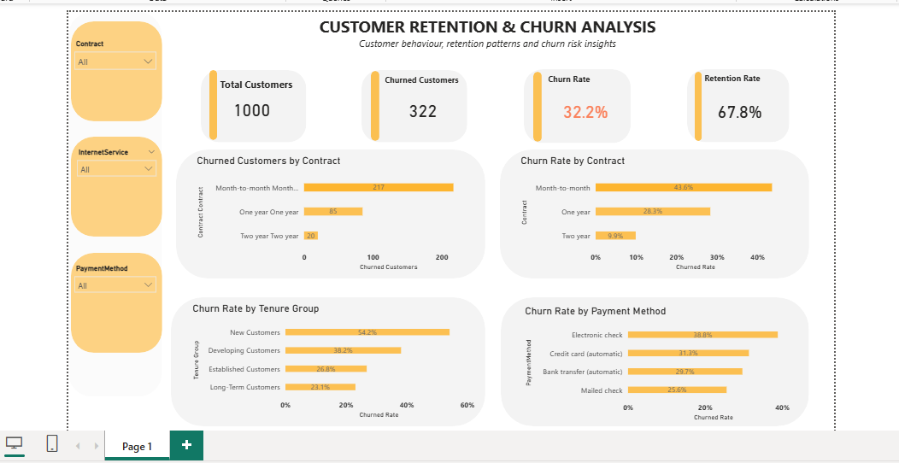

# Customer Behaviour & Retention Analysis

**Portfolio project | Microsoft Excel · Power BI · DAX**

> Descriptive analysis of customer churn patterns using a synthetic telecommunications dataset of 1,000 customer records.

## Project overview
This project explores customer churn across contract types, tenure groups and payment methods. The workflow includes data quality checks and exploratory analysis in Excel, followed by DAX calculations and an interactive Power BI dashboard. The objective is to identify customer segments with comparatively high churn rates and communicate evidence-based retention questions and recommendations.

## Business questions
- What proportion of customers are classified as churned and retained?
- How does churn vary by contract type?
- How does churn vary across tenure groups?
- How does churn vary by payment method?

## Tools
- **Microsoft Excel:** data inspection, validation, formulas and exploratory analysis.
- **Microsoft Power BI:** data import, KPI cards, charts, slicers and interactive reporting.
- **DAX:** reusable measures for customer counts, churn, retention and average monthly charges.

## Dataset
The synthetic practice dataset contains **1,000 records and 21 columns** covering customer demographics, services, contract information, payment method, tenure, charges and churn status. It is intended for educational and portfolio demonstration only.

## Data preparation and quality checks
Excel checks covered missing values, duplicate customer IDs, tenure outside 1–72 months, non-positive monthly charges, negative total charges, SeniorCitizen values outside 0/1, phone/internet category consistency and churn values outside Yes/No. The reported checks returned zero exceptions for the defined rules. Passing these checks does not establish that synthetic records reflect real customer behaviour.

## Analysis methodology
1. Calculated total customers, churned customers, retained customers, churn rate, retention rate and average monthly charges.
2. Grouped customers by contract type, tenure and payment method.
3. Compared churn counts and churn rates across groups.
4. Built DAX measures and Power BI visuals.
5. Added Contract, InternetService and PaymentMethod slicers. The project author tested the slicers and confirmed that report visuals updated.

## Key results

### Overall KPIs
| Metric | Result |
|---|---:|
| Total customers | 1,000 |
| Churned customers | 322 |
| Retained customers | 678 |
| Churn rate | 32.2% |
| Retention rate | 67.8% |
| Average tenure | 36.05 months |
| Average monthly charges | 73.50 |

### Churn by contract type
| Contract type | Customers | Churned | Churn rate |
|---|---:|---:|---:|
| Month-to-month | 498 | 217 | 43.6% |
| One year | 300 | 85 | 28.3% |
| Two year | 202 | 20 | 9.9% |

### Churn by tenure group
| Tenure group | Tenure | Customers | Churned | Churn rate |
|---|---|---:|---:|---:|
| New | 0–12 months | 168 | 91 | 54.2% |
| Developing | 13–24 months | 173 | 66 | 38.2% |
| Established | 25–48 months | 343 | 92 | 26.8% |
| Long-term | 49–72 months | 316 | 73 | 23.1% |

### Churn by payment method
| Payment method | Customers | Churned | Churn rate |
|---|---:|---:|---:|
| Bank transfer | 263 | 78 | 29.7% |
| Credit card | 252 | 79 | 31.3% |
| Electronic check | 309 | 120 | 38.8% |
| Mailed check | 176 | 45 | 25.6% |

### Main observations
- New customers had the highest churn rate among tenure groups (54.2%).
- Month-to-month customers had the highest churn rate among contract types (43.6%).
- Electronic-check customers had the highest churn rate among payment methods (38.8%).
- Churn rates were lower in longer tenure groups and longer contract categories in this dataset.

These are descriptive associations, not evidence of cause and effect.

## Recommendations
1. Review the month-to-month customer experience and test suitable value propositions that may encourage customers to consider longer-term plans.
2. Strengthen onboarding and early-life engagement during the first 12 months.
3. Investigate electronic-check customers further, including contract mix, tenure, service usage, billing experience and complaint patterns.
4. Monitor churn by segment over time to assess whether retention initiatives are associated with improved outcomes.

## Power BI dashboard
The report includes KPI cards for total customers, churned customers, churn rate and retention rate; churn charts by contract, tenure and payment method; and slicers for Contract, InternetService and PaymentMethod.

### Dashboard screenshot
Place the final report screenshot at `Screenshots/customer_retention_dashboard.png`.



## Limitations
- The dataset is synthetic; results do not represent verified performance for a real telecommunications company.
- The analysis identifies associations and does not establish causation.
- The project does not measure the financial impact or effectiveness of recommendations.
- Further validation would require real customer data, service-quality indicators, complaint records and longitudinal outcomes.

## Skills demonstrated
Excel data validation · Exploratory Data Analysis · Data quality assurance · Customer segmentation · KPI development · DAX · Power BI · Dashboard development · Data visualisation · Business interpretation · Communication of insights

## Repository structure
```text
Customer-Behaviour-Retention-Analysis/
├── README.md
├── Dataset/
│   └── Customer_Behaviour_Retention_Project.xlsx
├── PowerBI/
│   └── Customer_Behaviour_Retention_Analysis.pbix
├── Screenshots/
│   └── customer_retention_dashboard.png
└── Documentation/
    └── Customer_Behaviour_Retention_Case_Study.docx
```

